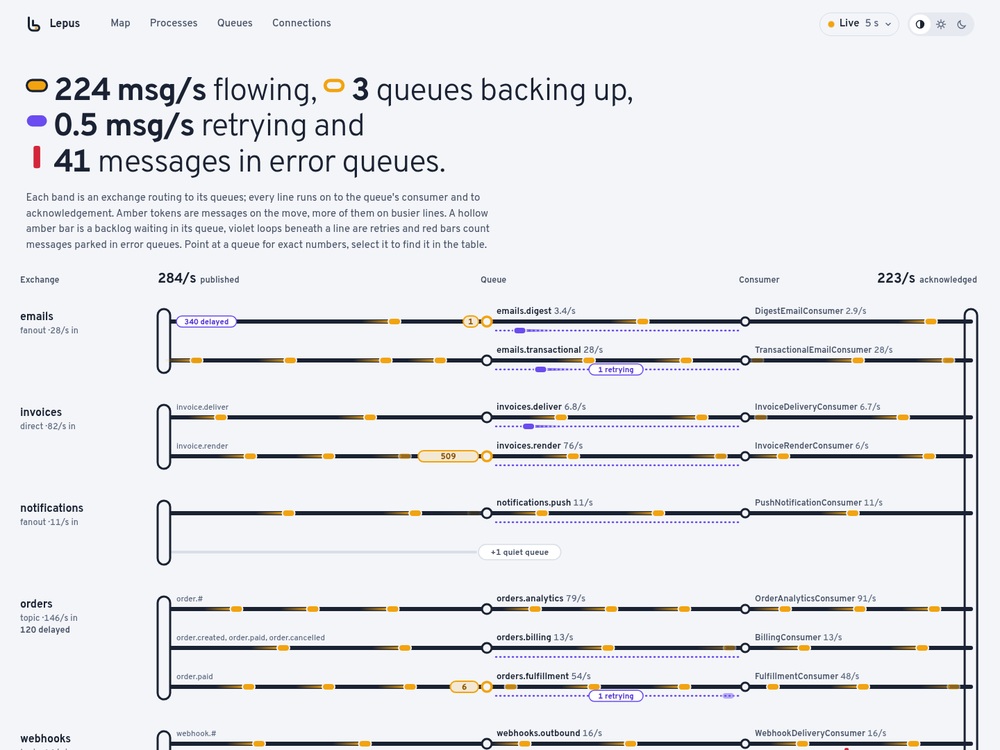

# Web Dashboard



Lepus ships a Rack-based monitoring UI: a live map of how messages move from exchanges through queues to consumers, the broker's message rates, and the supervisors, workers, queues and connections behind them.

## Running it standalone

```bash
bundle exec lepus web --port 9292 --host 0.0.0.0
```

Visit http://localhost:9292.

## Mounting in Rails

```ruby
# config/routes.rb
require 'lepus/web'

authenticate :user, ->(u) { u.admin? } do
  mount Lepus::Web => '/lepus'
end
```

Or with Devise:

```ruby
authenticate :admin_user do
  mount Lepus::Web => '/admin/lepus'
end
```

**Important:** the dashboard has no built-in auth. Wrap it with whatever your app already uses.

## What it shows

- **Topology map.** Each exchange is a band of lines, one per bound queue, running exchange → queue → consumer → acknowledged. Amber tokens ride each segment at a pace that grows with its message rate (on a log scale, capped), a hollow amber bar is a backlog piling up at its queue, violet loops under a line are messages waiting in the retry queue and red bars count messages parked in the error queue. Messages delayed on purpose (see below) wait in a teal clock pill tucked under the queue they will be released to, or under the exchange name when they are released to the exchange; they are never counted as backlog or retries. Quiet queues, and anything past the busiest few per exchange, fold into a "+N" row you can expand. Point at or focus a queue for exact numbers; select it to find it in the queues table.
- **Headline.** Messages flowing, queues backing up (growing, or with nobody reading them), messages retrying, messages delayed (when there are any) and messages in error queues, in one sentence that also serves as the map's key.
- **Message rates.** Published, delivered, acknowledged and redelivered per second across the broker over the last 10 minutes or hour, from the samples the management API keeps, with a table view.
- **Queues.** Every main queue under the exchange that routes to it, in the map's order, with each exchange's totals; a queue bound to several exchanges sits under the first and notes the others, and queues with no binding come last under "Default exchange", as on the map. Columns are ready (with how fast a growing backlog grows), unacked, consumers, published, delivered and acknowledged per second (on an exchange's row, Published/s is what reaches the exchange), and the messages in the queue's retry and error queues ("–" when it has none). Sorting orders the queues within each exchange. Expand a queue to see its retry, delay and error queues with their own counts and what their arguments do ("retries after 5 s, back to orders.billing", "delivers after 5 s to orders.billing, expires when unused for 1 h"). A queue's row says how many messages wait in its delay queues and for how long ("340 delayed for 1 min and 1 h"); an exchange's delay queues are listed right under the exchange, and its totals include everything delayed for it. Idle queues are muted, and an exchange's idle queues fold into one row; on a broker with more than 30 queues each exchange shows its first six and folds the rest into "+N more queues". Selecting a queue on the map brings its row into view, unfolded, expanded and focused; a queue's name leads back to it on the map.
- **Processes.** Supervisors, their workers (PID, memory, connections, heartbeat health) and each consumer's processed, rejected and errored counts since the worker started. A consumer configured with `delays:` lists them, and messages it handed back with `delay!` count as delayed rather than processed.
- **Connections.** The broker's client connections.

Retry and error queues are recognised from what consumers report in their heartbeats, from their arguments (a TTL queue that dead-letters into a queue which dead-letters back is its retry queue; a queue another one dead-letters into is its error queue) and from the `.retry` / `.error` suffixes. A queue a consumer reads, or one bound to a named exchange, is always drawn as a main queue.

Delay queues are the ones Lepus declares for [delayed messages](../README.md#delayed-messages), recognised by their name and arguments together: `<queue>.delay.<ms>` with an `x-message-ttl` of `<ms>` dead-letters into `<queue>` through the default exchange (a `delay:` publish through the default exchange, or a consumer's `delay!`), and `<exchange>.delayed.<ms>` with an `x-message-ttl` of `<ms>` dead-letters into `<exchange>`, keeping the routing key, behind the `<exchange>.delayed` headers exchange (a `delay:` publish to any other exchange). The `<exchange>.delayed` exchange draws no band of its own. A delay queue RabbitMQ deleted after `x-expires` (`config.delay_queue_expires` past its delay) simply drops off the next poll.

## Refreshing

The page polls every 5 seconds by default. The **Live** control in the top bar pauses it or switches to 2, 5, 15 or 60 seconds, and the choice is remembered in the browser. Polling also stops while the tab is in the background, and tokens freeze while paused. The light/dark theme follows the system unless you pick one.

The page loads nothing from other origins (its font is bundled), uses no inline scripts or styles and is served with a strict `Content-Security-Policy`. Earlier versions installed a service worker for offline use; it now removes itself and its caches on the next visit.

## Trying it without RabbitMQ

From a checkout of the gem:

```bash
bin/web-demo                 # http://127.0.0.1:9393
HEAVY=1 bin/web-demo         # ~70 queues on 12 exchanges, 20 workers, deep backlogs
MOUNT=/lepus bin/web-demo    # served under a sub-path, like a Rails mount
```

It simulates a broker whose rates drift, with a backlog that builds and drains and a burst of errors every few minutes.

## Registry backend

The dashboard reads from the process registry, configured at `Lepus.configure`:

```ruby
config.process_registry_backend = :file      # single-host
# or
config.process_registry_backend = :rabbitmq  # multi-host
```

- `:file` — metadata stored under `/tmp/lepus/...`. Works out of the box but only for a single host.
- `:rabbitmq` — metadata stored in RabbitMQ itself. Multiple `lepus start` processes across multiple hosts show up in one dashboard.

For `:rabbitmq`, also set:

```ruby
config.management_api_url = 'http://rabbitmq:15672'
```

## Heartbeats

Each worker heartbeats into the registry every `config.process_heartbeat_interval` (default 60 seconds). Processes are considered "alive" if their last heartbeat is within `config.process_alive_threshold` (default 5 minutes).

## API endpoints

The dashboard is a single page reading a small read-only JSON API under `/api/...`. You can use it directly for custom dashboards or alerting:

- `GET /api/topology`: exchanges, bindings (with their routing keys), queues with their role (`main`, `retry`, `error`, `delay`) and parent, rates and backlog, message TTL, dead-letter exchange and routing key and `x-expires`, and the consumers of each queue (with their `delayed` count and `delays`) merged from the broker and worker heartbeats. A delay queue also has `delay_ms`, `target` and `target_type` (`queue` or `exchange`); every queue and exchange has `delayed`, the messages waiting to be released to it, and `delays`, the delays they wait; a `<exchange>.delayed` exchange has role `delay` and `releases_to`, and bindings carry the `delays` of their `lepus-delay` header. `management` is `false` (with `management_error`) when the management API did not answer; the topology is then what consumers declared.
- `GET /api/overview?age=600|3600`: broker-wide message rates, queue totals and rate history over the window.
- `GET /api/processes`: every process sending heartbeats, with per-consumer counts.
- `GET /api/queues`, `GET /api/exchanges`, `GET /api/connections`: the management API's lists.
- `GET /api/meta`: version, heartbeat settings and polling choices.
- `GET /api/health`

`/api/processes`, `/api/meta` and `/api/health` work without the RabbitMQ Management API. `/api/topology` degrades to what worker heartbeats declared when it is missing, and the rest need it (`config.management_api_url`, default `http://<rabbitmq host>:15672`, credentials and vhost taken from `rabbitmq_url`). When it fails, the dashboard only says whether it was unreachable, rejected the credentials or returned an error; the details go to the log.

## Prometheus metrics

See [prometheus.md](prometheus.md) for the metric list, label cardinality notes, and how to wire the collector server inside a Lepus supervisor process.

## Operating in production

- Put the dashboard behind your existing auth layer (OAuth proxy, Rails authentication, Basic auth).
- Use `:rabbitmq` registry backend for multi-node visibility.
- Retain logs separately — the dashboard is for live state, not audit trails.
